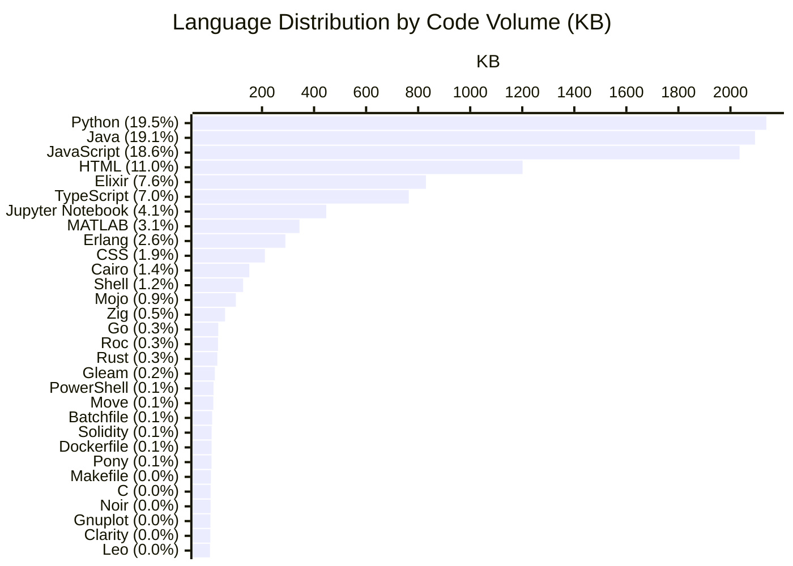
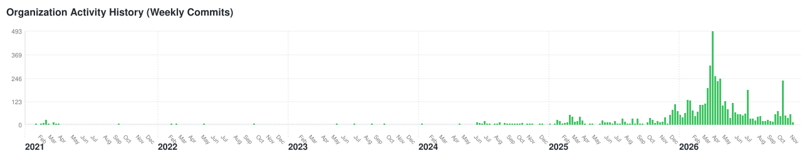

## Welcome to the Kathiravelu Lab.

We are part of the Alaska open-source ecosystem.

We build open-source research frameworks in distributed systems, healthcare informatics, and cloud computing.

## 🔬 Projects

<!-- REPO-LIST:START -->
> Last updated: 2026-11-25 21:50 UTC · 56 active public repositories

| Repository | Language | Description | Stars | Forks | Commits |
| --- | :---: | --- | :---: | :---: | :---: |
| [**.github**](https://github.com/KathiraveluLab/.github) |  | .github repository | ⭐ 1 | 🍴 1 | 🚀 483 |
| [**3-Chess**](https://github.com/KathiraveluLab/3-Chess) |  | A 3-player chess game |  |  | 🚀 8 |
| [**Acer-Swift-Go-16-AI-Bugs**](https://github.com/KathiraveluLab/Acer-Swift-Go-16-AI-Bugs) |  | Bugs encountered in Acer Swift Go 16 AI |  |  | 🚀 3 |
| [**AirportSim**](https://github.com/KathiraveluLab/AirportSim) |  | CSCEA365-Assignment-1 |  |  | 🚀 4 |
| [**Alaskan-Season-of-Code**](https://github.com/KathiraveluLab/Alaskan-Season-of-Code) | — | A repository to hold the project ideas and past and current participants of Alaskan Season of Code |  |  | 🚀 12 |
| [**Ararat**](https://github.com/KathiraveluLab/Ararat) |  | DHG Workflow Executor |  | 🍴 1 | 🚀 37 |
| [**AWANTA**](https://github.com/KathiraveluLab/AWANTA) |  | An SD-WAN framework for telehealth access | ⭐ 4 | 🍴 6 | 🚀 311 |
| [**Beehive**](https://github.com/KathiraveluLab/Beehive) |  | A Data Federation Approach to Analyze Behavioral Health and Supplement Healthcare Practice with Community Health Metrics in Alaska | ⭐ 27 | 🍴 71 | 🚀 1409 |
| [**C3B**](https://github.com/KathiraveluLab/C3B) | — | Community Computing Capacity Building |  |  | 🚀 1 |
| [**CAN**](https://github.com/KathiraveluLab/CAN) |  | Content-Aware-Networking |  |  | 🚀 9 |
| [**Cassowary**](https://github.com/KathiraveluLab/Cassowary) |  | Middleware Platform for Context-Aware Smart Buildings with Software-Defined Sensor Networks |  |  | 🚀 69 |
| [**CHIEF**](https://github.com/KathiraveluLab/CHIEF) |  | Controller Farm for Clouds of Software-Defined Community Networks |  | 🍴 1 | 🚀 33 |
| [**Cloud2Sim**](https://github.com/KathiraveluLab/Cloud2Sim) |  | An Adaptive and Distributed Architecture for Cloud and MapReduce Algorithms and Simulations. |  | 🍴 1 | 🚀 105 |
| [**conf-chat**](https://github.com/KathiraveluLab/conf-chat) | — | A P2P Chat |  | 🍴 25 | 🚀 1 |
| [**CSCEA365-Group-Projects**](https://github.com/KathiraveluLab/CSCEA365-Group-Projects) | — | CSCE A365 Group Project |  | 🍴 9 | 🚀 3 |
| [**DataLake**](https://github.com/KathiraveluLab/DataLake) |  | DataLake Demo |  |  | 🚀 4 |
| [**DIA**](https://github.com/KathiraveluLab/DIA) |  | DICOM Image Albums |  |  | 🚀 2 |
| [**Diomede**](https://github.com/KathiraveluLab/Diomede) |  | Dynamic DICOM Endpoint Routing | ⭐ 17 | 🍴 47 | 🚀 511 |
| [**Distributed-Computing**](https://github.com/KathiraveluLab/Distributed-Computing) |  | Class resources for the Distributed Computing course |  |  | 🚀 11 |
| [**Dragonfly**](https://github.com/KathiraveluLab/Dragonfly) | — | Distributed Computing Sample Project |  | 🍴 27 | 🚀 3 |
| [**DREAMS**](https://github.com/KathiraveluLab/DREAMS) |  | Digitization for Recovery: Exploring Arts with Mining for Societal well-being. | ⭐ 8 | 🍴 34 | 🚀 735 |
| [**dudu**](https://github.com/KathiraveluLab/dudu) |  | Distributed Near Duplicate Detection for Big Data |  |  | 🚀 42 |
| [**DWiM**](https://github.com/KathiraveluLab/DWiM) |  | DICOM Workflows in MATLAB | ⭐ 1 | 🍴 5 | 🚀 234 |
| [**Epicue**](https://github.com/KathiraveluLab/Epicue) |  | Equity, Privacy, and Integrity with Cairo in Untrusted Environments |  |  | 🚀 99 |
| [**Evora**](https://github.com/KathiraveluLab/Evora) |  | Composing network service chains at the edge: A Resilient and adaptive software‐defined approach |  | 🍴 1 | 🚀 70 |
| [**Explore**](https://github.com/KathiraveluLab/Explore) |  | A game inspired by Portugal |  |  | 🚀 3 |
| [**Faro**](https://github.com/KathiraveluLab/Faro) |  | Near-duplicate detection | ⭐ 2 | 🍴 3 | 🚀 37 |
| [**FIRM**](https://github.com/KathiraveluLab/FIRM) |  | Find, Invoke, Return, and Manage |  |  | 🚀 17 |
| [**geo-el**](https://github.com/KathiraveluLab/geo-el) |  | This is a geography game written in Elixir |  |  | 🚀 18 |
| [**GUARDA**](https://github.com/KathiraveluLab/GUARDA) |  | Gateway for Uniform Access to Remote Data and Analytics |  | 🍴 1 | 🚀 19 |
| [**IGUANA**](https://github.com/KathiraveluLab/IGUANA) |  | Integrated Guardrails for Unbiased and Adaptive Neural Network Architectures |  |  | 🚀 133 |
| [**L4SBOA**](https://github.com/KathiraveluLab/L4SBOA) |  | L4S Bandwidth Orchestration Architecture | ⭐ 5 | 🍴 6 | 🚀 245 |
| [**LAGOS**](https://github.com/KathiraveluLab/LAGOS) |  | Latency-aware Accountable Governance for Overlay Scaling |  |  | 🚀 42 |
| [**MEDIator**](https://github.com/KathiraveluLab/MEDIator) |  | On-Demand Big Data Integration-as-a-Service: A Data Federation Framework for Reproducible Science |  | 🍴 1 | 🚀 380 |
| [**memories**](https://github.com/KathiraveluLab/memories) |  | An exploration game inspired by Lisboa |  |  | 🚀 50 |
| [**messaging4transport**](https://github.com/KathiraveluLab/messaging4transport) |  | Message Oriented Middleware for OpenDaylight MD-SAL |  |  | 🚀 30 |
| [**Metro**](https://github.com/KathiraveluLab/Metro) |  | A metro map of KathiraveluLab Research |  |  | 🚀 43 |
| [**Mojito**](https://github.com/KathiraveluLab/Mojito) |  | Mojo-based Integrated Task Orchestrator |  |  | 🚀 8 |
| [**NetUber**](https://github.com/KathiraveluLab/NetUber) |  | Software-Defined Internet |  |  | 🚀 37 |
| [**Obidos**](https://github.com/KathiraveluLab/Obidos) |  | On-Demand Big Data Integration: A Hybrid ETL Approach for Reproducible Scientific Research |  |  | 🚀 59 |
| [**PORTO**](https://github.com/KathiraveluLab/PORTO) |  | Private Off-chain Resource Tracking and Orchestration. |  |  | 🚀 54 |
| [**robin**](https://github.com/KathiraveluLab/robin) |  | A NodeJS-based proxy for A/B testing |  | 🍴 1 | 🚀 132 |
| [**RocK**](https://github.com/KathiraveluLab/RocK) |  | Roc-based blocks |  |  | 🚀 4 |
| [**sanfrancisco**](https://github.com/KathiraveluLab/sanfrancisco) | — | Data Mining Course Project | ⭐ 1 | 🍴 24 | 🚀 3 |
| [**SD-CPS**](https://github.com/KathiraveluLab/SD-CPS) |  | Software-Defined Cyber-Physical Systems |  |  | 🚀 53 |
| [**SDDS**](https://github.com/KathiraveluLab/SDDS) |  | Software-Defined Data Services |  | 🍴 1 | 🚀 24 |
| [**SENDIM**](https://github.com/KathiraveluLab/SENDIM) |  | A Simulation, Emulation, aNd Deployment Integration Middleware for cloud networks. |  |  | 🚀 14 |
| [**SFILS**](https://github.com/KathiraveluLab/SFILS) | — | An integrated library system for the San Francisco Public Library. |  | 🍴 38 | 🚀 10 |
| [**Sintra**](https://github.com/KathiraveluLab/Sintra) |  | Self-adaptive Interdomain Network Transport for Real-Time Applications | ⭐ 3 | 🍴 6 | 🚀 108 |
| [**SMART**](https://github.com/KathiraveluLab/SMART) |  | SDN Middlebox Architecture for Resilient Transfers |  |  | 🚀 41 |
| [**SOFIA**](https://github.com/KathiraveluLab/SOFIA) |  | Service-Oriented Federated Interoperability Architecture |  |  | 🚀 56 |
| [**TENeT**](https://github.com/KathiraveluLab/TENeT) |  | Telehealth Effectiveness and Necessity Tracker | ⭐ 6 | 🍴 24 | 🚀 298 |
| [**text-based-coding**](https://github.com/KathiraveluLab/text-based-coding) |  | Text-based Coding in Python. A UAA Summer Engineering Academy session | ⭐ 1 |  | 🚀 16 |
| [**Viseu**](https://github.com/KathiraveluLab/Viseu) |  | Virtual Internet Services at the Edge | ⭐ 2 |  | 🚀 198 |
| [**XPD**](https://github.com/KathiraveluLab/XPD) |  | XPD, a Mark-Compact Collector algorithm implementation for MMTk and a micro-benchmark for the GC algorithms in Java, named XPDBench. |  |  | 🚀 24 |
| [**xSDN**](https://github.com/KathiraveluLab/xSDN) |  | An expressive simulator for dynamic network flows. |  |  | 🚀 65 |
<!-- REPO-LIST:END -->

## 📊 Language Distribution

<!-- LANG-CHART:START -->

<!-- LANG-CHART:END -->

## 📈 Organization Activity

<!-- ACTIVITY-CHART:START -->

  

<!-- ACTIVITY-CHART:END -->

## Frequent Contributors

<!-- CONTRIBUTORS:START -->
<table style="border-collapse: collapse; border: none;">
  <tr>
    <td align="center" style="border: none; padding: 10px;"><a href="https://github.com/pradeeban"> <b>pradeeban</b></a> 2978 contributions</td>
    <td align="center" style="border: none; padding: 10px;"><a href="https://github.com/iprasannamb"> <b>iprasannamb</b></a> 224 contributions</td>
    <td align="center" style="border: none; padding: 10px;"><a href="https://github.com/mdxabu"> <b>mdxabu</b></a> 175 contributions</td>
    <td align="center" style="border: none; padding: 10px;"><a href="https://github.com/dakshhhhh16"> <b>dakshhhhh16</b></a> 173 contributions</td>
    <td align="center" style="border: none; padding: 10px;"><a href="https://github.com/shivamyadavrgipt"> <b>shivamyadavrgipt</b></a> 169 contributions</td>
  </tr>
  <tr>
    <td align="center" style="border: none; padding: 10px;"><a href="https://github.com/KrishanYadav333"> <b>KrishanYadav333</b></a> 146 contributions</td>
    <td align="center" style="border: none; padding: 10px;"><a href="https://github.com/Pragya-rathal"> <b>Pragya-rathal</b></a> 107 contributions</td>
    <td align="center" style="border: none; padding: 10px;"><a href="https://github.com/01bps"> <b>01bps</b></a> 100 contributions</td>
    <td align="center" style="border: none; padding: 10px;"><a href="https://github.com/Sahil-u07"> <b>Sahil-u07</b></a> 95 contributions</td>
    <td align="center" style="border: none; padding: 10px;"><a href="https://github.com/ayusrjn"> <b>ayusrjn</b></a> 80 contributions</td>
  </tr>
  <tr>
    <td align="center" style="border: none; padding: 10px;"><a href="https://github.com/sk66641"> <b>sk66641</b></a> 74 contributions</td>
    <td align="center" style="border: none; padding: 10px;"><a href="https://github.com/jess-tech-lab"> <b>jess-tech-lab</b></a> 73 contributions</td>
    <td align="center" style="border: none; padding: 10px;"><a href="https://github.com/ishaanxgupta"> <b>ishaanxgupta</b></a> 66 contributions</td>
    <td align="center" style="border: none; padding: 10px;"><a href="https://github.com/anish1206"> <b>anish1206</b></a> 60 contributions</td>
    <td align="center" style="border: none; padding: 10px;"><a href="https://github.com/ASHISH-JHA94"> <b>ASHISH-JHA94</b></a> 60 contributions</td>
  </tr>
  <tr>
    <td align="center" style="border: none; padding: 10px;"><a href="https://github.com/madhavzanwar"> <b>madhavzanwar</b></a> 51 contributions</td>
    <td align="center" style="border: none; padding: 10px;"><a href="https://github.com/AnvayKharb"> <b>AnvayKharb</b></a> 47 contributions</td>
    <td align="center" style="border: none; padding: 10px;"><a href="https://github.com/yadavchiragg"> <b>yadavchiragg</b></a> 45 contributions</td>
    <td align="center" style="border: none; padding: 10px;"><a href="https://github.com/kartikeyg0104"> <b>kartikeyg0104</b></a> 45 contributions</td>
    <td align="center" style="border: none; padding: 10px;"><a href="https://github.com/AbrhamYishak"> <b>AbrhamYishak</b></a> 36 contributions</td>
  </tr>
</table>
<!-- CONTRIBUTORS:END -->
